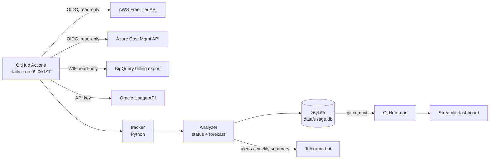

# ☁️ Multi-Cloud Free Tier Tracker

A bot that checks your **AWS, Azure, GCP and Oracle Cloud** usage every day and warns you on
**Telegram before you cross a free-tier limit**, with a live dashboard and trend-based forecasts
("at this rate you'll hit 750 EC2 hours on 27 Oct").

It runs entirely on free services and costs **₹0**. It also works with **no cloud account at all**
through its built-in mock mode.

---

## ✨ Features

- **4 clouds, 1 report:** AWS, Azure, GCP and Oracle behind one pluggable provider interface.
- **Mock mode:** realistic simulated usage, so you can build, test and demo without any account.
- **Forecasting:** projects month-end usage from the last 7 days' trend and predicts the day a limit will be crossed.
- **Smart alerts:** 🔵 projected → 🟡 80% → 🟠 95% → 🔴 over. Each level alerts once per month, so you're not spammed.
- **Weekly summary** on Telegram with progress bars.
- **Dashboard** (Streamlit) with history charts.
- **Serverless & scheduled:** GitHub Actions runs it daily, and the history is stored in SQLite in the repo.
- **Secure by design:** OIDC / Workload Identity Federation means **no cloud passwords or keys are stored**, and access is read-only and least-privilege.
- **Infrastructure as Code:** Terraform for all cloud access, plus a $1 AWS budget safety net.
- **Cost guards:** avoids paid APIs (AWS Cost Explorer) and caps BigQuery scans.
- **Tested:** 20 unit tests with fake cloud SDKs, run in CI before every tracker run.

## 🏗️ Architecture



## 📁 File structure

```
cloud-freetier-tracker/
├── README.md                    ← you are here
├── requirements.txt             ← Python packages (core + cloud SDKs)
├── requirements-dev.txt         ← + dashboard + pytest
├── .env.example                 ← template for local secrets
├── config/
│   └── limits.yaml              ← ALL settings: thresholds, clouds on/off, free limits, mock data
├── tracker/                     ← the Python app
│   ├── __main__.py              ← lets you run `python -m tracker`
│   ├── cli.py                   ← commands: run, seed, show, test-telegram
│   ├── config.py                ← loads limits.yaml + env overrides
│   ├── models.py                ← UsageRecord (one metric)
│   ├── analyzer.py              ← status, trend, month-end forecast, "limit hit on" date
│   ├── storage.py               ← SQLite history + alert de-duplication
│   ├── notifier.py              ← Telegram messages (alerts, summary, errors)
│   └── providers/
│       ├── base.py              ← Provider interface
│       ├── mock.py              ← fake data (no account needed)
│       ├── aws.py               ← Free Tier API (free) – credits + per-service usage
│       ├── azure.py             ← Consumption API – credit spent per service
│       ├── gcp.py               ← BigQuery billing export (scan-capped)
│       └── oracle.py            ← Usage API – any cost outside Always Free
├── dashboard/
│   ├── app.py                   ← Streamlit dashboard
│   └── requirements.txt         ← for Streamlit Community Cloud
├── data/
│   └── usage.db                 ← created on first run; committed by the workflow
├── tests/                       ← pytest (fake SDKs, no network)
├── terraform/
│   ├── aws/    main.tf          ← read-only OIDC role + $1 budget alert
│   ├── azure/  main.tf          ← OIDC app + Cost Management Reader
│   └── gcp/    main.tf          ← billing dataset + WIF + read-only service account
├── .github/workflows/
│   └── tracker.yml              ← tests → login → run → commit history
└── docs/
    ├── CLOUD_SETUP.md           ← connect each real cloud, step by step
    └── INTERVIEW_NOTES.md       ← how to explain this project in interviews
```

---

## 💸 Why it costs ₹0

| Piece | What it uses | Cost |
|---|---|---|
| Scheduler + compute | GitHub Actions on a **public** repo | Free |
| Database | SQLite file in the repo | Free |
| Alerts | Telegram Bot API | Free |
| Dashboard | Streamlit Community Cloud | Free |
| AWS data | Free Tier API (**not** Cost Explorer, which charges per call) | Free |
| Azure data | Consumption API | Free |
| GCP data | BigQuery, capped at 100 MB per query (free quota is 1 TiB/month) | Free |
| Oracle data | Usage API | Free |
| IaC | Terraform CLI | Free |

> Mock mode needs **no** cloud account and no card. Connecting real clouds is optional. Do it one at a time with `docs/CLOUD_SETUP.md`.

---

## 🚀 Step-by-step setup

### Step 0 – Install the tools (free)
- **Python 3.10+** from https://www.python.org/downloads/ (on Windows, tick **"Add python to PATH"**).
- **Git** from https://git-scm.com/downloads
- A **GitHub** account, plus a **Telegram** account on your phone.
- (Later, for real clouds) **Terraform** from https://developer.hashicorp.com/terraform/install

### Step 1 – Run it on your laptop (mock mode, 5 minutes)

Unzip the project, open a terminal **inside the folder**, then run:

**Windows (PowerShell)**
```powershell
python -m venv .venv
.venv\Scripts\Activate.ps1
pip install -r requirements-dev.txt
python -m pytest -q                      # should say: 20 passed
python -m tracker seed --days 30         # creates 30 days of fake history
python -m tracker run --dry-run          # prints the table + alert
streamlit run dashboard/app.py           # opens the dashboard in your browser
```

**Mac / Linux**
```bash
python3 -m venv .venv
source .venv/bin/activate
pip install -r requirements-dev.txt
python -m pytest -q
python -m tracker seed --days 30
python -m tracker run --dry-run
streamlit run dashboard/app.py
```

> If PowerShell blocks `Activate.ps1`, first run: `Set-ExecutionPolicy -Scope CurrentUser RemoteSigned`

### Step 2 – Create your Telegram bot (free)
1. In Telegram, open **@BotFather**, send `/newbot`, and pick a name. Copy the **token**.
2. Open your new bot and send it any message (for example, "hi").
3. In a browser, open `https://api.telegram.org/bot<TOKEN>/getUpdates` and copy the number at `"chat":{"id": ...}`. That's your **chat ID**.
4. Test it:
   - Windows: `$env:TELEGRAM_BOT_TOKEN="..."; $env:TELEGRAM_CHAT_ID="..."; python -m tracker test-telegram`
   - Mac/Linux: `TELEGRAM_BOT_TOKEN=... TELEGRAM_CHAT_ID=... python -m tracker test-telegram`

### Step 3 – Put it on GitHub (runs daily for free)
1. Create a **public** repository on GitHub named `cloud-freetier-tracker`. Public repos get free Actions minutes.
2. Push the code:
   ```bash
   git init
   git add .
   git commit -m "Multi-cloud free tier tracker"
   git branch -M main
   git remote add origin https://github.com/<your-username>/cloud-freetier-tracker.git
   git push -u origin main
   ```
   If you ran `seed` locally, `data/usage.db` is pushed too, so the dashboard starts with history. If you'd rather start clean, delete it first.
3. In the repo, go to **Settings → Secrets and variables → Actions**:
   - **Secrets** tab: add `TELEGRAM_BOT_TOKEN` and `TELEGRAM_CHAT_ID`.
   - **Variables** tab: add `TRACKER_PROVIDERS` = `mock`. You'll change this later to e.g. `aws,azure`.
4. Go to **Settings → Actions → General → Workflow permissions**, choose **Read and write permissions**, and save.
5. Go to the **Actions** tab → **Free Tier Tracker** → **Run workflow**. After about a minute you get a Telegram alert, and a new commit updates `data/usage.db`.

From now on it runs every day at 09:00 IST.

### Step 4 – Deploy the dashboard (free)
1. Go to https://share.streamlit.io and sign in with GitHub.
2. Click **Create app**, pick your repo, branch `main`, and main file `dashboard/app.py`. Deploy.
3. Put the dashboard link at the top of this README and on your resume.

> Note: the dashboard shows usage numbers publicly. They're harmless (no account IDs or keys), but if you prefer, keep `TRACKER_PROVIDERS=mock` for the public demo.

### Step 5 – Connect real clouds (optional, one at a time)
Follow **[docs/CLOUD_SETUP.md](docs/CLOUD_SETUP.md)**. The safest order is:
1. **Azure for Students** (no card needed)
2. **AWS** (create the $1 budget first, which the Terraform does for you)
3. **Oracle Cloud**
4. **GCP**

Then set the `TRACKER_PROVIDERS` variable to, for example, `azure,aws`.

---

## ⚙️ Commands

| Command | What it does |
|---|---|
| `python -m tracker run` | Fetch → analyze → save → alert |
| `python -m tracker run --dry-run` | Same, but print alerts instead of sending them |
| `python -m tracker run --summary` | Also send the weekly summary now |
| `python -m tracker run --date 2026-10-15` | Pretend it's another day (for testing) |
| `python -m tracker seed --days 30` | Fill mock history for charts |
| `python -m tracker show` | Print the latest saved numbers |
| `python -m tracker test-telegram` | Send a test message |

All settings live in **`config/limits.yaml`**: thresholds, which clouds are on, credit amounts, GCP SKU limits, and mock data. Free-tier rules change, so check the official pages linked at the top of that file every few months.

## 🧪 Tests
```bash
python -m pytest -q
```
The tests use **fake cloud SDKs**, so they need no account and no network. CI runs them before every tracker run.

## 🛠️ Troubleshooting

| Problem | Fix |
|---|---|
| `No module named tracker` | Run commands from the project root folder (where README.md is). |
| `SDK for 'aws' is not installed` | `pip install -r requirements.txt` |
| Workflow can't push | Settings → Actions → General → **Read and write permissions** |
| No Telegram message | Re-check the chat ID, and make sure you messaged the bot at least once. |
| Scheduled runs stopped | GitHub pauses schedules in repos with no activity for 60 days. Make any commit or click **Run workflow**. |
| A cloud shows "FAILED" | You get a Telegram error message with the reason. See `docs/CLOUD_SETUP.md`. |

## 🗺️ Ideas to extend
- Optional auto-stop of an EC2/VM tagged `autostop=true` when its limit is close.
- Slack or Discord notifier (add a new class next to `Notifier`).
- More granular Azure always-free meters.
- Multi-account support (AWS Organizations).

## 📄 License
MIT – use it, change it, show it off.
